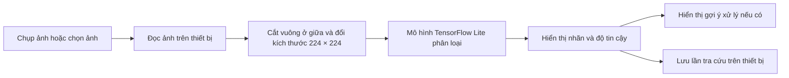

<div align="center">

# 🌱 AgriVision

### Trợ lý nhận diện bệnh cây trồng bằng trí tuệ nhân tạo

**Chụp ảnh · Nhận diện tại thiết bị · Xem gợi ý xử lý**

Ứng dụng Flutter hỗ trợ nhận biết một số bệnh thường gặp trên cây ngô, ớt chuông,
khoai tây và cà chua từ ảnh lá cây.

<br>


**Tác giả: Lê Phú An**

</div>

---

## 📌 Mục lục

- [Giới thiệu](#-giới-thiệu)
- [Tính năng](#-tính-năng)
- [Cây trồng và nhãn nhận diện](#-cây-trồng-và-nhãn-nhận-diện)
- [Quy trình hoạt động](#-quy-trình-hoạt-động)
- [Công nghệ sử dụng](#-công-nghệ-sử-dụng)
- [Cấu trúc dự án](#-cấu-trúc-dự-án)
- [Cài đặt và chạy ứng dụng](#-cài-đặt-và-chạy-ứng-dụng)
- [Huấn luyện và đánh giá mô hình](#-huấn-luyện-và-đánh-giá-mô-hình)
- [Lưu ý khi sử dụng](#-lưu-ý-khi-sử-dụng)
- [Đóng góp](#-đóng-góp)
- [Tác giả](#-tác-giả)

## 🌾 Giới thiệu

AgriVision là ứng dụng hỗ trợ người trồng cây tham khảo tình trạng sức khỏe của
cây thông qua hình ảnh lá. Người dùng có thể chụp ảnh trực tiếp hoặc chọn ảnh từ
thư viện; mô hình TensorFlow Lite được tích hợp trong ứng dụng sẽ phân loại ảnh
thành một trong **19 nhãn** và hiển thị tên dự đoán cùng độ tin cậy.

Ứng dụng còn lưu các lần tra cứu trên thiết bị và hiển thị gợi ý xử lý tương ứng
với một số bệnh đã có hướng dẫn. AgriVision hướng tới trải nghiệm đơn giản, thuận
tiện và có thể thực hiện suy luận ngay trên thiết bị mà không cần gửi ảnh lên
máy chủ.

> **Lưu ý:** Kết quả là thông tin tham khảo từ mô hình AI, không thay thế chẩn
> đoán của chuyên gia bảo vệ thực vật hoặc cán bộ khuyến nông.

## ✨ Tính năng

- **Chụp ảnh cây trồng:** mở máy ảnh từ ứng dụng để chụp ảnh cần kiểm tra.
- **Chọn ảnh có sẵn:** tải ảnh từ thư viện trên thiết bị.
- **Nhận diện bằng AI:** sử dụng mô hình TensorFlow Lite được đóng gói cùng ứng
  dụng; kết quả gồm nhãn dự đoán và độ tin cậy.
- **Gợi ý xử lý:** hiển thị hướng dẫn cho một số bệnh đã được khai báo trong
  ứng dụng; các trường hợp khác nhận khuyến nghị theo dõi và hỏi cán bộ khuyến
  nông.
- **Lịch sử tra cứu:** lưu nhãn dự đoán, độ tin cậy, thời điểm và đường dẫn ảnh
  trên thiết bị bằng `shared_preferences`.
- **Giao diện tiếng Việt:** thao tác tập trung trên một màn hình, với tông màu
  xanh lá phù hợp chủ đề nông nghiệp.

## 🍃 Cây trồng và nhãn nhận diện

Mô hình ứng dụng được cấu hình với 19 nhãn thuộc bốn nhóm cây:

| Cây trồng | Các nhãn |
|---|---|
| **Ngô** | Đốm lá xám (*Cercospora*), rỉ sắt, cháy lá (*Northern Leaf Blight*), khỏe mạnh |
| **Ớt chuông** | Đốm vi khuẩn, khỏe mạnh |
| **Khoai tây** | Mốc sương sớm, mốc sương mai, khỏe mạnh |
| **Cà chua** | Đốm vi khuẩn, mốc sương sớm, mốc sương mai, nấm mốc lá, đốm lá *Septoria*, nhện đỏ, đốm vòng (*Target Spot*), xoăn lá vàng do virus, khảm lá do virus, khỏe mạnh |

Tên nhãn hiển thị trong ứng dụng được khai báo trong
[`ml_service.dart`](UI/agrivision_app/lib/ml_service.dart).

## 🔄 Quy trình hoạt động



Ứng dụng tải mô hình từ `assets/models/agrivision_tf_model.tflite`. Mã suy luận
tiền xử lý ảnh bằng cách cắt phần vuông ở giữa, thu nhỏ về `224 × 224` rồi đưa
các kênh RGB vào mô hình.

## 🧰 Công nghệ sử dụng

| Thành phần | Công nghệ |
|---|---|
| Ứng dụng | Flutter, Dart, Material |
| Chọn ảnh/chụp ảnh | `image_picker` |
| Xử lý ảnh | `image` |
| Suy luận trên thiết bị | TensorFlow Lite qua `tflite_flutter` |
| Lưu lịch sử cục bộ | `shared_preferences` |
| Mô hình trong ứng dụng | `UI/agrivision_app/assets/models/agrivision_tf_model.tflite` |
| Mã nghiên cứu/huấn luyện | Python, PyTorch, Torchvision |
| Kiến trúc trong mã huấn luyện | EfficientNet-B0 |

## 🗂 Cấu trúc dự án

```text
AgriVision-main/
├── models/
│   ├── agrivision_tf_model.tflite
│   └── best_agrivision_tf.keras
├── notebooks/
│   └── 01_data_exploration.ipynb
├── src/
│   ├── data_loader.py        # Nạp dữ liệu và chia tập train/validation
│   ├── model.py              # Khởi tạo EfficientNet-B0
│   ├── train.py              # Huấn luyện mô hình PyTorch
│   ├── evaluate.py           # Dự đoán thử trên một ảnh
│   ├── confusion_matrix.py   # Báo cáo phân loại và ma trận nhầm lẫn
│   ├── explain_model.py      # Trực quan hóa Grad-CAM
│   └── export_model.py       # Xuất mô hình PyTorch sang ONNX
└── UI/
    └── agrivision_app/
        ├── assets/models/
        │   └── agrivision_tf_model.tflite
        ├── lib/
        │   ├── main.dart         # Giao diện và luồng ứng dụng
        │   ├── ml_service.dart   # Nạp mô hình và suy luận ảnh
        │   └── disease_data.dart # Gợi ý xử lý bệnh
        └── pubspec.yaml
```

## 🚀 Cài đặt và chạy ứng dụng

### Yêu cầu

- Flutter SDK tương thích với ràng buộc Dart `^3.11.3` trong `pubspec.yaml`.
- Android Studio hoặc thiết bị Android đã bật USB debugging; hoặc một thiết bị/
  trình giả lập iOS trên macOS.
- Cấu hình máy ảnh/thư viện ảnh phù hợp với thiết bị và nền tảng đang chạy.

### Chạy trên thiết bị hoặc trình giả lập

Mở terminal tại thư mục ứng dụng Flutter:

```powershell
cd UI\agrivision_app
flutter doctor
flutter pub get
flutter devices
flutter run
```

Chọn thiết bị đích nếu Flutter phát hiện nhiều thiết bị:

```powershell
flutter run -d <device_id>
```

### Kiểm tra mã nguồn Flutter

Từ `UI\agrivision_app`, chạy:

```powershell
flutter analyze
flutter test
```

### Tạo bản Android

```powershell
cd UI\agrivision_app
flutter build apk --release
```

APK đầu ra thường nằm tại:

```text
build/app/outputs/flutter-apk/app-release.apk
```

## 🧪 Huấn luyện và đánh giá mô hình

Thư mục `src/` chứa mã Python phục vụ thử nghiệm mô hình PyTorch EfficientNet-B0.
Dữ liệu huấn luyện không được đóng gói sẵn trong dự án. Cấu hình mặc định của
các script trỏ tới `data/raw/PlantVillage_Filtered` và mong đợi dữ liệu theo cấu
trúc thư mục lớp, tương thích với `torchvision.datasets.ImageFolder`:

```text
data/raw/PlantVillage_Filtered/
├── Corn_class_name/
│   ├── image_001.jpg
│   └── ...
├── Pepper_class_name/
├── Potato_class_name/
└── Tomato_class_name/
```

### Chuẩn bị môi trường Python

Cài đặt Python cùng các thư viện mà các script sử dụng:

```powershell
python -m venv .venv
.\.venv\Scripts\Activate.ps1
python -m pip install --upgrade pip
python -m pip install torch torchvision numpy scikit-learn matplotlib seaborn opencv-python pillow grad-cam sympy
```

### Huấn luyện

Đặt dữ liệu ở đường dẫn mặc định như trên, sau đó chạy từ thư mục `src`:

```powershell
cd src
python train.py
```

`data_loader.py` chia dữ liệu thành 80% train và 20% validation, dùng seed cố
định để chia tập; tập train có tăng cường ảnh cơ bản. Cấu hình gọi mặc định
trong `train.py` là 5 epoch, batch size 6. Trọng số tốt nhất được ghi vào
`models/best_agrivision_model.pth`.

### Các công cụ phân tích

Các lệnh sau cũng chạy từ `src`. Một số script cần tệp trọng số PyTorch được tạo
ở bước huấn luyện và ảnh/dữ liệu kiểm thử phù hợp.

```powershell
python evaluate.py
python confusion_matrix.py
python explain_model.py
python export_model.py
```

- `evaluate.py`: phân loại một ảnh kiểm thử bằng trọng số PyTorch.
- `confusion_matrix.py`: tạo báo cáo phân loại và ma trận nhầm lẫn.
- `explain_model.py`: tạo trực quan hóa Grad-CAM.
- `export_model.py`: xuất trọng số `.pth` sang định dạng ONNX.

> Các script nghiên cứu/huấn luyện PyTorch và mô hình TensorFlow Lite được
> đóng gói trong ứng dụng là các phần riêng trong repository. `export_model.py`
> hiện xuất ONNX; script này không tự chuyển mô hình sang TFLite.

## ⚠️ Lưu ý khi sử dụng

- Chụp ảnh lá rõ nét, đủ sáng, lấy nét vào vùng cần kiểm tra và hạn chế nền quá
  rối để có kết quả tham khảo tốt hơn.
- Mô hình chỉ phân loại trong phạm vi 19 nhãn nêu trên. Cây trồng, bệnh hoặc
  điều kiện ảnh ngoài phạm vi này có thể dẫn tới kết quả không chính xác.
- Độ tin cậy do mô hình trả về không đồng nghĩa với xác suất chẩn đoán chính xác
  ngoài thực tế.
- Hướng dẫn xử lý trong ứng dụng chỉ được khai báo sẵn cho một số bệnh. Luôn
  đọc kỹ nhãn thuốc, hướng dẫn an toàn và quy định địa phương; hỏi cán bộ
  chuyên môn trước khi xử lý cây trồng.
- Lịch sử được lưu cục bộ trên thiết bị, không đồng bộ lên máy chủ. Ảnh trong
  lịch sử tham chiếu tới đường dẫn ảnh đã chọn; nếu ảnh bị di chuyển hoặc xóa,
  ảnh xem lại có thể không còn khả dụng.
- Dữ liệu PlantVillage và trọng số `.pth` do quá trình huấn luyện tạo ra không
  được bao gồm sẵn trong cấu trúc hiện tại; cần tự chuẩn bị nếu muốn chạy pipeline
  huấn luyện/đánh giá PyTorch.

## 🤝 Đóng góp

Nếu muốn cải thiện AgriVision, bạn có thể:

1. Tạo bản sao (fork) của dự án.
2. Tạo nhánh riêng cho thay đổi của mình.
3. Kiểm tra thay đổi bằng `flutter analyze`/`flutter test` hoặc các kiểm tra Python
   phù hợp.
4. Gửi pull request kèm mô tả rõ nội dung và mục đích.

## 👨‍💻 Tác giả

**Lê Phú An**

---

<div align="center">

🌿 *AgriVision — đồng hành cùng nhà nông từ một chiếc lá khỏe mạnh.*

</div>
